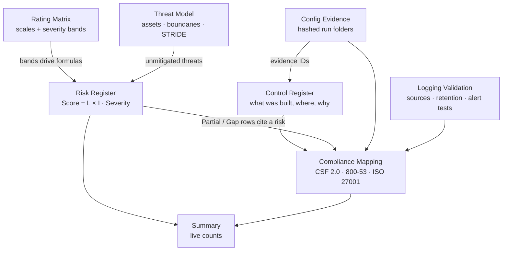

# security-assessment-toolkit

The working papers I use for a cloud security assessment, as one Excel workbook: rating matrix, threat model, risk register, control register, compliance mapping, configuration evidence and logging validation. A blank template, a fully worked example for a fictional company, and the Python script that builds both.

> The example organisation (Contoso Clinic), its system and every finding are invented. No client material is included in this repository.

## What is in the workbook

| Sheet | What it holds | Feeds |
|---|---|---|
| **Read Me** | Order of work, colour legend, scoring and evidence rules | |
| **Summary** | Live counts by severity and status, and compliance status counts | Executive summary |
| **Rating Matrix** | 3×3 likelihood and impact scales written for the environment, severity bands with required response times, heat map | Every Severity formula |
| **Threat Model** | Assets, trust boundaries, STRIDE at each boundary with the control in place and the gap | Risk Register |
| **Risk Register** | One finding per row; Score and Severity are formulas; status, action, owner role, due date, framework references | Summary, findings report |
| **Control Register** | Every rule, policy, role and alert the build created, where it lives, why it exists, NIST 800-53 / CSF 2.0 / ISO 27001:2022 mapping | Compliance Mapping |
| **Compliance Mapping** | CSF 2.0 function and category to SP 800-53 and ISO/IEC 27001:2022 Annex A, with Met / Partial / Gap and the evidence or risk behind it | Summary |
| **Config Evidence** | Evidence index plus the repository and package scan method (gitleaks, trivy, npm audit) | Every "Built" or "Met" claim |
| **Logging Validation** | Log source inventory and retention, plus a firing test log for every alert rule | Detect and Respond rows |

## How the pieces connect



## Rules the workbook enforces

- **Score and Severity are never typed.** Score = Likelihood × Impact. Severity comes from the bands on the Rating Matrix sheet, so agreeing a different band re-rates every risk at once.
- **Confirmed data exposure is Critical at any score**, through a single Override column that accepts only "Critical".
- **No evidence, no "Met".** Every Built or Met row names an evidence ID from the Config Evidence sheet. Evidence folders carry SHA-256 manifests (see [azure-posture-check](https://github.com/richdieu-max/azure-posture-check)).
- **Owners are roles, not people**, so the register stays valid when staff change.
- **An alert is validated only when someone received it.** The firing log records how each rule was triggered safely, when, by which role, and whether the notification arrived.

## Files

```text
templates/security-assessment-template.xlsx   blank workbook, one example row per sheet
templates/csv/                                 the same tables as CSV
examples/contoso-clinic-assessment.xlsx        fully worked fictional example
examples/csv/                                  the example tables as CSV (diff-friendly)
docs/method.md                                 how I run an assessment with these sheets
tools/build_workbook.py                        builds both workbooks (openpyxl)
```

Colour convention in the workbook: blue text is input, black text is formula, yellow fill is waiting for input, blue italic is an example row to replace.

## Rebuild

```bash
pip install openpyxl
python tools/build_workbook.py            # templates/
python tools/build_workbook.py --example  # examples/
```

Open the file in Excel once (or recalculate in LibreOffice) to populate formula results.

## License

MIT. See [LICENSE](LICENSE).
