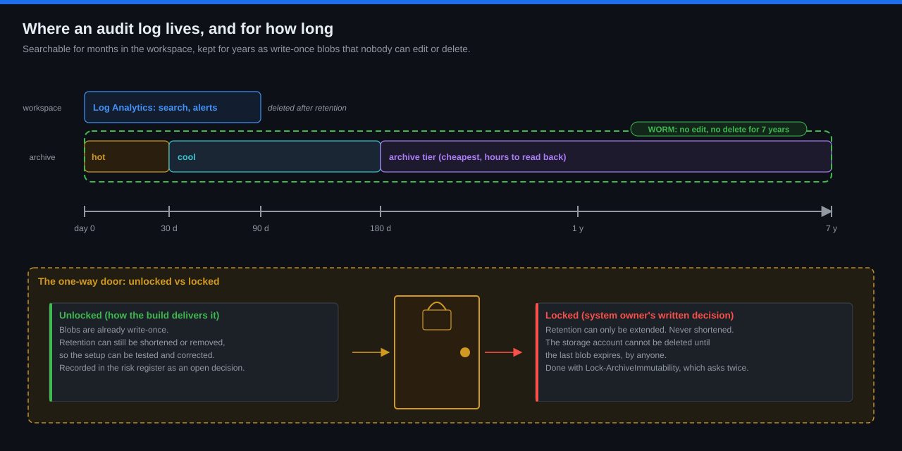
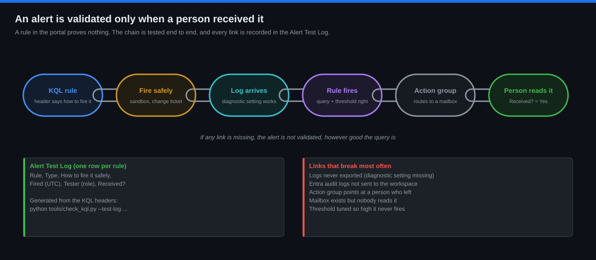

# Logging: archive, alert rules and firing tests (skeleton)

The workbook's **Logging Validation** sheet asks two questions: *where does each log go and for how long*, and *does each alert actually reach a person*. This folder is the build behind those answers.

```
log-archive/
  log-archive.bicep                    storage account with WORM (immutable) container and lifecycle tiering
  activity-log-export.bicep            subscription activity log to the workspace AND the archive
  Lock-ArchiveImmutability.skeleton.ps1  the irreversible lock, for the system owner, report-only by default
kql/
  *.kql                                10 alert rules, each with a header (severity, schedule, controls, ATT&CK, how to fire it)
  INDEX.md                             generated table of the rules
alert-test-log.template.csv            one row per rule, same columns as the workbook's Alert Test Log
```

## Retention: searchable for months, kept for years



- **Log Analytics** keeps 90 to 365 days for searching and alerting.
- **The archive** keeps 7 years (2555 days, a parameter) as write-once blobs. Lifecycle rules move them to cool after 30 days and to the archive tier after 180, which is where the long tail becomes cheap.
- The account uses "selected networks" with the trusted-services bypass, because diagnostic settings write to it as a trusted Azure service. Shared-key access is off unless a writer genuinely needs it.

### Why the immutability policy is delivered unlocked

| | Unlocked | Locked |
|---|---|---|
| Blobs can be edited or deleted | No | No |
| Retention can be shortened or removed | **Yes** | **Never** |
| Storage account can be deleted | Yes | Not until the last blob expires |
| Who decides | the build | the system owner, in writing |

Locking is a one-way door. The build delivers the policy unlocked so it can be tested and corrected, records the open decision in the risk register, and hands over `Lock-ArchiveImmutability.skeleton.ps1`. That script reports by default, and to lock it needs `-Lock`, a decision reference, the account name typed back, and PowerShell's own confirmation.

## Alert rules

[kql/INDEX.md](kql/INDEX.md) lists all ten. Each `.kql` file starts with a header:

```kql
// id: KQL-05
// title: Network security group rule created, changed or deleted
// severity: 2
// table: AzureActivity
// frequency: PT5M
// window: PT10M
// threshold: > 0
// controls: CM-3; SC-7; AU-6
// attack: T1562.007
// fire-test: Add and remove a deny rule with a high priority number on a sandbox NSG.
AzureActivity
| where OperationNameValue in~ ("MICROSOFT.NETWORK/NETWORKSECURITYGROUPS/SECURITYRULES/WRITE", ...)
```

The rules cover what an attacker does to stay in or cover tracks in an Azure tenant: role assignments at high scope, new app credentials, break-glass sign-ins, unexpected Key Vault reads, NSG and policy changes, WAF block spikes, failed backups, and changes to the log archive or diagnostic settings themselves.

`python tools/check_kql.py` checks every header, unique IDs, severity range, that the query starts with the table it names, and that brackets and quotes balance. CI runs it on every push.

## An alert counts only when a person received it



Each header's `fire-test` says how to trigger the rule safely (sandbox resources, a change ticket, the planned break-glass test). `python tools/check_kql.py --test-log logging/alert-test-log.template.csv` turns those into an Alert Test Log with the same columns as the workbook. A rule is validated when its row has a time, a tester role and **Received? = Yes**.

## Left out of the skeleton

Account-level version immutability (so containers Azure creates later inherit WORM), a private endpoint for the archive, Entra ID diagnostic settings, and deploying the KQL as scheduled query rules (`Microsoft.Insights/scheduledQueryRules`) bound to the platform action group.
