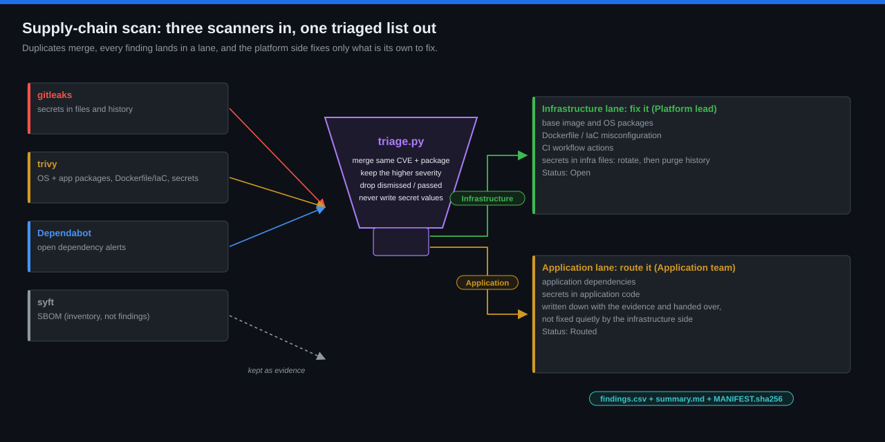

# Supply-chain scan (skeleton)

Secrets, vulnerable packages, misconfiguration and an SBOM for a repository or release folder, triaged into **one list** with duplicates merged, and every finding placed in a lane: fixed on the infrastructure side, or routed to the application team. The output feeds the workbook's **Config Evidence** and **Risk Register** sheets.



## Files

```
scan.sh                 runs gitleaks, trivy, syft (and Dependabot alerts if configured), then triage
triage.py               merges and triages the reports into findings.csv and summary.md
tests/test_triage.py    unit tests (python -m unittest)
examples/               FICTIONAL reports used by the tests and CI
workflow.example.yml    a GitHub Actions workflow to copy into a product repository
```

## Run it

```bash
./supply-chain-scan/scan.sh ./path/to/repo ./evidence/scan-001
# optional: Dependabot alerts too
DEPENDABOT_REPO=owner/repo ./supply-chain-scan/scan.sh ./path/to/repo
```

A scanner that is not installed is recorded as **skipped** in `tools.txt`, never as clean. Every file in the evidence folder is listed in `MANIFEST.sha256` (`sha256sum -c MANIFEST.sha256` verifies it).

Triage the fictional examples:

```bash
python3 supply-chain-scan/triage.py \
  --gitleaks supply-chain-scan/examples/gitleaks.sample.json \
  --trivy supply-chain-scan/examples/trivy.sample.json \
  --dependabot supply-chain-scan/examples/dependabot.sample.json --out /tmp/triage
```

```
ID      Source            Severity  Lane            Status  Item
SC-001  trivy             Critical  Application     Routed  example-parser 0.9.0 (package-lock.json)
SC-002  trivy+dependabot  High      Application     Routed  example-http 2.1.0 (package-lock.json)
SC-003  gitleaks          High      Application     Routed  src/config/defaults.js:7
SC-004  gitleaks          High      Infrastructure  Open    .github/workflows/release.yml:42
SC-005  trivy             High      Infrastructure  Open    Dockerfile (DS002: image runs as root)
SC-006  trivy             High      Infrastructure  Open    libexample 1.0.0 (base image)
SC-007  dependabot        Medium    Infrastructure  Open    example/upload-action (CI workflow)
```

## Triage rules

| Rule | Why |
|---|---|
| Same CVE (or GHSA) in the same package from two tools becomes one row, with both sources and the higher severity | one problem, one owner, one fix |
| Dismissed Dependabot alerts and passed Trivy checks are dropped | they are decisions already made |
| Base image and OS packages, Dockerfile/IaC misconfiguration, CI actions and secrets in infra files go to **Infrastructure** (Status: Open) | the platform side owns them |
| Application dependencies and secrets in application code go to **Application** (Status: Routed) | handed over with the evidence, not fixed quietly by the infrastructure side |
| Secret values are never written, even if a report contains them | the evidence must be safe to share |
| A secret finding says *rotate first, then purge history* | removing it from git does not un-leak it |

`--fail-on-critical-infra` makes the script exit 1 when an open Critical infrastructure finding exists, for use as a pipeline gate.
